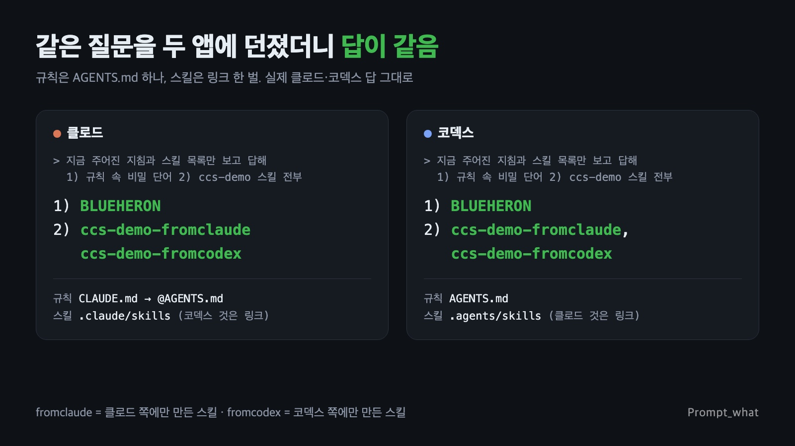

# claude-codex-sync

<sub>[한국어 README](README.md)</sub>

**Make Codex read the same skills and rules you already built for Claude.** Edit once, both tools see it.

- **Skills**: linked, not copied. One copy on disk, so versions never drift.
- **Rules**: `AGENTS.md` is the single source; `CLAUDE.md` imports it with one `@AGENTS.md` line.
- **Safety**: three commands, `check`, `install`, `undo`. Nothing original is deleted; files it rewrites are backed up first.



<sub>Real answers from Claude and Codex in a test project linked by this skill. Both found the skill that existed only on the Claude side and the one that existed only on the Codex side. (Screenshot text is Korean.)</sub>

## Download

**[Latest release](../../releases/latest)** (`.skill` and `.zip`, same contents)

## Install

Easiest: send this to Claude.

```
Install the skill at https://github.com/promptwhat/claude-codex-sync and link Claude and Codex
```

Manual:

```bash
mkdir -p ~/.claude/skills && unzip ~/Downloads/claude-codex-sync-v1.4.zip -d ~/.claude/skills
bash ~/.claude/skills/claude-codex-sync/scripts/ccsync.sh check
bash ~/.claude/skills/claude-codex-sync/scripts/ccsync.sh install
```

Add `--project <dir>` to also link a project's `CLAUDE.md`/`AGENTS.md` and `.claude/skills` ↔ `.agents/skills`.

## Verify

`check` only verifies files. Restart both apps, then ask each one:

```
Without opening any files, using only the instructions and skill list you were given: 1) quote the first rule in my rules 2) list every skill name you can use
```

Same rule and same skill names from both means you are done.

## What gets linked

| What | Claude reads | Codex reads | How |
|---|---|---|---|
| Skills | `~/.claude/skills` | `~/.agents/skills` | symlink; the side with the real folder is the source |
| Global rules | `~/.claude/CLAUDE.md` | `~/.codex/AGENTS.md` | `CLAUDE.md` imports `@~/.codex/AGENTS.md` |
| Project rules | `<project>/CLAUDE.md` | `<project>/AGENTS.md` | side by side, `@AGENTS.md` |
| Project skills | `.claude/skills` | `.agents/skills` | relative symlinks (survive moving the repo) |

## Limits

- Model differences remain; Codex runs GPT models. This aligns skills and rules only.
- Does not share chat history or memory, and does not hand work off between apps.
- Runs in Claude on your own computer (terminal, or the desktop app's Code tab). Not for claude.ai chat skills, cloud sessions, or desktop Cowork sessions.
- macOS and Linux (incl. WSL) only.
- Every case `check` flags (doc size limit, `AGENTS.override.md`, parent-folder rules, missing `name`/`description`, Claude-only tools, …) and its fix is listed in [SKILL.md](claude-codex-sync/SKILL.md) (Korean).

## Undo

```bash
bash ~/.claude/skills/claude-codex-sync/scripts/ccsync.sh undo
```

Removes only links this tool created, and turns the import line back into the current `AGENTS.md` content. Failed items stay in the log so you can fix the cause and rerun. Exit codes: `0` clean, `1` needs attention, `2` write/restore failure.

## Tests

`bash ~/.claude/skills/claude-codex-sync/scripts/test_ccsync.sh` runs everything in a fake home folder and prints `PASS`. All 15 issues from four external reviews are covered; passes on macOS stock bash 3.2.

## License

[MIT](LICENSE). Made by [promptwhat (@prompt_what)](https://www.instagram.com/prompt_what/).
